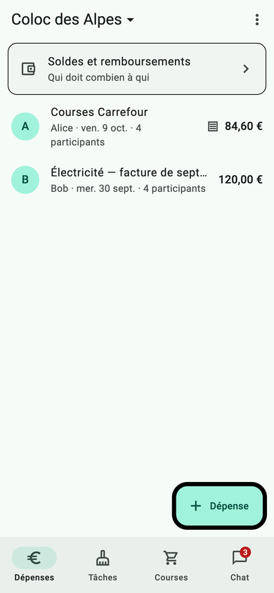
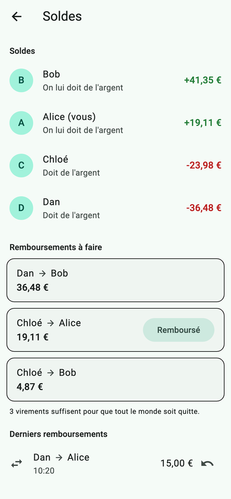
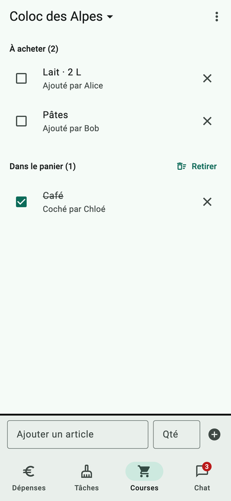
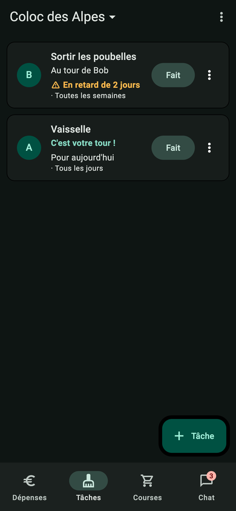

# Colloc'

Application mobile de gestion de colocation : dépenses partagées et soldes, tâches ménagères avec rotation, liste de courses et chat en temps réel.
**Flutter + Supabase**, projet BTS SIO de **Louis HERZOG** et **Romain AUBREE** (sujet : [`[Projet] Colloc' gestion….pdf`](<[Projet] Colloc' gesti... _ BTS SIO D.Villars Gap.pdf>)).

| Dépenses | Soldes | Courses | Chat | Thème sombre |
|---|---|---|---|---|
|  |  |  |  |  |

## Arborescence

```
.
├── app/                      application Flutter
│   ├── lib/
│   │   ├── modeles/          classes Dart (Depense, Membre, Tache…)
│   │   ├── donnees/          dépôts : SEUL endroit qui appelle Supabase (+ temps réel)
│   │   ├── etat/             session, état du réseau, base des ViewModels
│   │   ├── vues/             écrans + leur ViewModel (ChangeNotifier), par fonctionnalité
│   │   ├── widgets/          composants réutilisables (états vide / erreur, avatar, bandeau…)
│   │   └── outils/           montants, dates, répartition, simplification des dettes
│   ├── test/                 tests unitaires et de widgets (flutter test)
│   └── test_integration/     tests de la couche de données contre le Supabase local
├── supabase/
│   ├── migrations/           schéma complet : tables, contraintes, RLS, RPC, Storage, Realtime
│   ├── seed.sql              comptes et données de démo (base locale uniquement)
│   ├── tests/                tests SQL pgTAP (soldes du jalon 3, isolement des colocs)
│   └── config.toml           configuration de la base locale (Supabase CLI)
├── tests_e2e/                répétition automatique du jalon 4 (Playwright)
├── docs/                     conception (jalon 1), jalon 3, audit de sécurité, captures
├── lancer.sh / lancer.bat    lanceurs macOS-Linux / Windows
├── env.example.json          modèle de configuration (copié en env.json, ignoré par Git)
├── DECISIONS.md              décisions d'architecture
└── JOURNAL.md                journal de bord
```

## Mise en route

### 1. La base de données

**Option A — Supabase en ligne** (pour la démo sur deux téléphones) : dans *SQL Editor*, exécutez tout le fichier [`supabase/migrations/20261009000000_schema_initial.sql`](supabase/migrations/20261009000000_schema_initial.sql). Pour les comptes de test, désactivez *Authentication → Sign In / Providers → Email → Confirm email*.

**Option B — Supabase local** (développement, tests ; nécessite Docker et le [Supabase CLI](https://supabase.com/docs/guides/local-development)) :

```bash
supabase start      # à la racine du dépôt : applique le schéma et les données de démo
supabase status     # affiche l'URL (http://127.0.0.1:54621) et la clé anon
```

Les ports (546xx) ne gênent pas les autres projets Supabase locaux. Comptes de démo (mot de passe `motdepasse123`) : `alice@`, `bob@`, `chloe@`, `dan@colloc.test` (Coloc des Alpes, code `GAPDE-MXV27`) et `eve@colloc.test` (seule dans sa coloc, pour le test d'intrusion).

### 2. La configuration

Copiez `env.example.json` en `env.json`, puis renseignez l'URL et la clé **anon** (*Project Settings → API*, ou `supabase status` en local). Le lanceur le fait pour vous au premier lancement.

> ⚠️ La clé `service_role` (ou `sb_secret_…`) ne doit **jamais** apparaître dans le dépôt ni dans l'application : un seul manquement entraîne un malus. Les lanceurs refusent de démarrer s'ils la trouvent.

### 3. Le lancement

- **Windows :** double-cliquez sur `lancer.bat`, ou tapez `lancer.bat -d chrome` dans un terminal.
- **macOS / Linux :** `./lancer.sh`, ou `./lancer.sh -d macos`.
- **VS Code :** configuration « Colloc' » (`F5`), déjà prête dans `.vscode/launch.json`.

Le lanceur vérifie Flutter, l'application et `env.json`, lance `flutter pub get`, propose un appareil, puis exécute `flutter run --dart-define-from-file=env.json`.

**Prérequis sous Windows :**
- Flutter dans le `PATH` (`flutter doctor`).
- Pour l'application **Windows (bureau)** : Visual Studio 2022 avec « Développement Desktop en C++ », et le **mode développeur** activé (`start ms-settings:developers`).
- Pour **Android** : un émulateur démarré ou un téléphone en débogage USB. Sur l'émulateur, `127.0.0.1` est automatiquement remplacé par `10.0.2.2` pour joindre le Supabase local.

## Tests

| Commande | Ce qu'elle vérifie |
|---|---|
| `cd app && flutter test` | 22 tests : simplification des dettes, montants, répartition, formulaires (nouvelle dépense, connexion), tous les écrans en thèmes clair et sombre sans débordement |
| `supabase test db` | 11 tests SQL (pgTAP) : soldes du jeu du jalon 3, arrondis, somme des parts, isolement entre colocs (RLS) |
| `cd app && flutter test test_integration --dart-define-from-file=../env.json` | 7 tests de la couche de données contre le **vrai** Supabase local, dont le temps réel entre deux utilisateurs (lancer `supabase db reset` avant) |
| `tests_e2e/jalon4.mjs` | Répétition du jalon 4 dans deux navigateurs : synchronisation, coupure et retour du réseau (mode d'emploi en tête du fichier) |

Captures d'écran à jour pour la soutenance : `cd app && flutter test test/ecrans_test.dart --update-goldens --dart-define=CAPTURES=true`.

## Jalon 2 : vérifier la RLS avec `curl`

```bash
URL=http://127.0.0.1:54621         # ou https://VOTRE-PROJET.supabase.co
ANON=VOTRE_CLE_ANON

# 1. Jeton de Bob
TOKEN_B=$(curl -s "$URL/auth/v1/token?grant_type=password" -H "apikey: $ANON" \
  -H "Content-Type: application/json" -d '{"email":"bob@colloc.test","password":"motdepasse123"}' | jq -r .access_token)

# 2. Lire les dépenses de la coloc d'Ève, dont Bob ne fait PAS partie → []
curl -s "$URL/rest/v1/depenses?colocation_id=eq.22222222-0000-4000-8000-000000000002" \
  -H "apikey: $ANON" -H "Authorization: Bearer $TOKEN_B"

# 3. S'inscrire soi-même dans cette coloc → refusé (403)
curl -s -X POST "$URL/rest/v1/membres" -H "apikey: $ANON" -H "Authorization: Bearer $TOKEN_B" \
  -H "Content-Type: application/json" \
  -d '{"colocation_id":"22222222-0000-4000-8000-000000000002","utilisateur_id":"bbbbbbbb-0000-4000-8000-000000000002"}'
```

D'autres attaques à tester pour l'audit croisé : [`docs/audit-securite.md`](docs/audit-securite.md).
