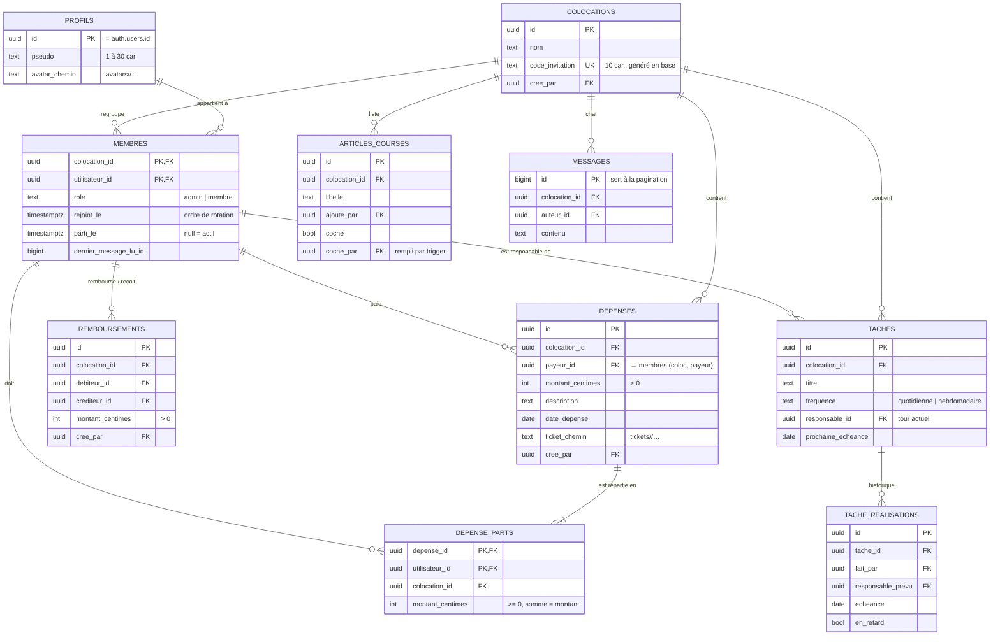
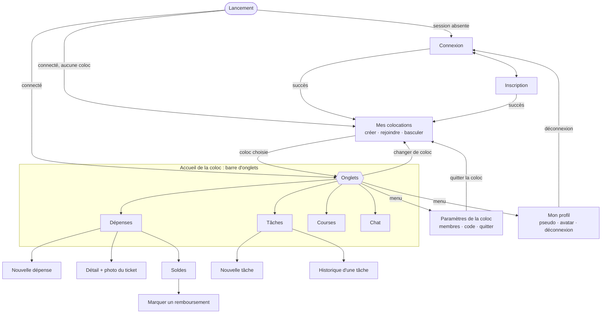

# Dossier de conception — jalon 1

Ce dossier contient les livrables à faire valider **avant d'écrire du code Flutter** :

1. le schéma de la base de données (diagramme ci-dessous + script [`supabase/schema.sql`](../supabase/schema.sql)) ;
2. la matrice d'autorisations ;
3. les 5 écrans clés et le graphe de navigation (les maquettes, elles, se font sur papier) ;
4. le découpage en tâches.

Les choix sont justifiés dans [`DECISIONS.md`](../DECISIONS.md).

---

## 1. Schéma de la base de données

**À retenir :**
- Les montants sont en **centimes entiers** (D1).
- Un départ ne supprime rien : on renseigne `membres.parti_le` (Q6).
- Les clés composites `(colocation_id, x_id) → membres` garantissent que le payeur, les participants, le débiteur, le créancier et le responsable font partie de **la même** coloc (Q3).
- La vue `soldes` (une ligne par membre) calcule : payé − parts dues + remboursements versés − remboursements reçus. La somme des soldes d'une coloc vaut exactement 0.
- Les opérations en plusieurs étapes passent par des RPC : `creer_colocation`, `rejoindre_colocation`, `regenerer_code`, `retirer_membre`, `quitter_colocation`, `creer_depense`, `terminer_tache`.

---

## 2. Matrice d'autorisations

**Légende :** **L** lire · **C** créer · **M** modifier · **S** supprimer · — aucun droit · *(RPC)* uniquement via la fonction indiquée.
Un visiteur **non connecté** n'a aucun droit sur aucune table. « Membre » veut dire membre **actif** de la coloc concernée.

| Données | Non-membre (connecté) | Membre | Auteur de la ligne | Admin |
|---|---|---|---|---|
| `profils` | L, M son propre profil seulement | L profils des colocataires (actuels et anciens) | M pseudo, avatar (son profil) | comme membre |
| `colocations` | C *(RPC `creer_colocation`)* | L (y compris le code) | — | M nom · S · régénérer le code *(RPC)* |
| `membres` | rejoindre avec le code *(RPC)* | L · quitter *(RPC)* · M son « dernier message lu » | — | retirer un membre *(RPC)* |
| `depenses` | — | L · C *(RPC `creer_depense`)*, payeur = membre actif | M description, date, ticket · S | M · S |
| `depense_parts` | — | L · C avec sa dépense *(RPC)*, participants actifs | (suivent leur dépense) | (suivent leur dépense) |
| `remboursements` | — | L · C seulement s'il est débiteur ou créancier | S (annuler) | S |
| vue `soldes` | — | L | — | — |
| `taches` | — | L · C · marquer faite *(RPC `terminer_tache`)* | M titre, fréquence · S | M · S |
| `tache_realisations` | — | L (écrites seulement par la RPC) | — | — |
| `articles_courses` | — | L · C · M (cocher, libellé) · S | — | — |
| `messages` | — | L · C (en son nom) | S | S |
| Storage `tickets/<coloc>/` | — | L · C | S (son fichier) | — |
| Storage `avatars/<utilisateur>/` | — | L avatars des colocataires | C · M · S (son dossier) | — |

**Jamais modifiables par un client :** `cree_par`, `colocation_id`, `role`, `parti_le`, `coche_par`, les dates de création, l'historique des tâches. La base l'impose par des droits **colonne par colonne** (section 7 du script).

---

## 3. Écrans clés et navigation

### Les 5 écrans à maquetter sur papier

Pour chaque écran, dessiner aussi l'**état de chargement**, l'**état vide** et l'**état d'erreur ou hors connexion**.

1. **Connexion / inscription** : e-mail, mot de passe, pseudo (inscription), messages d'erreur.
2. **Mes colocations** : liste des colocs (pour basculer de l'une à l'autre), boutons « Créer » et « Rejoindre avec un code ». État vide : « Vous n'avez pas encore de coloc ».
3. **Nouvelle dépense** : montant, description, date, payeur (liste des membres), participants (cases à cocher), interrupteur « parts égales / personnalisées » avec le total restant à répartir, photo du ticket.
4. **Soldes** : solde de chaque membre (vert : on lui doit, rouge : il doit), liste des virements proposés (« Bob → Alice : 12,50 € ») avec un bouton « Marquer comme remboursé ».
5. **Chat** : messages (les miens à droite), chargement des anciens messages en remontant, bouton « ↓ nouveaux messages », zone de saisie.

### Graphe de navigation

La redirection est **automatique** : l'application écoute `onAuthStateChange` et affiche Connexion ou Mes colocations selon la session.

---

## 4. Découpage en tâches

> Remplacez « Prénom N » par vos prénoms et ajustez au nombre de membres du groupe. Chacun commite **ses** fonctionnalités, avec des commits réguliers : l'historique Git est noté.

| Lot | Contenu | Responsable | Étape |
|---|---|---|---|
| Base de données | Relecture de `schema.sql`, création du projet Supabase, test `curl` du jalon 2 | Prénom 1 | 1–2 |
| Socle Flutter | `flutter create`, structure des dossiers, `config.dart`, modèles, repositories, thèmes clair/sombre | Prénom 2 | 2 |
| Comptes | Inscription, connexion, redirection automatique, profil + avatar | Prénom 3 | 2 |
| Colocations | Créer, rejoindre par code, basculer, paramètres (membres, code, quitter) | Prénom 1 | 2 |
| Dépenses | Formulaire (répartition égale ou personnalisée), photo du ticket, liste | Prénom 2 | 3 |
| Soldes | Écran Soldes, simplification des dettes + tests unitaires, remboursements, jeu de test du jalon 3 | Prénom 3 | 3 |
| Tâches | Liste, création, « fait », historique, indicateur de retard | Prénom 1 | 4 |
| Courses | Liste en temps réel, qui a ajouté ou coché quoi | Prénom 2 | 4 |
| Chat | Temps réel, pagination, nouveaux messages | Prénom 3 | 4 |
| Robustesse | Widgets communs (chargement, vide, erreur), bandeau hors connexion, reconnexion Realtime | tous | 4–5 |
| Qualité | 5 tests automatisés minimum, audit de sécurité croisé, soutenance | tous | 5 |
| Suivi | `JOURNAL.md` à chaque séance, `DECISIONS.md` à chaque choix | tous | continu |
